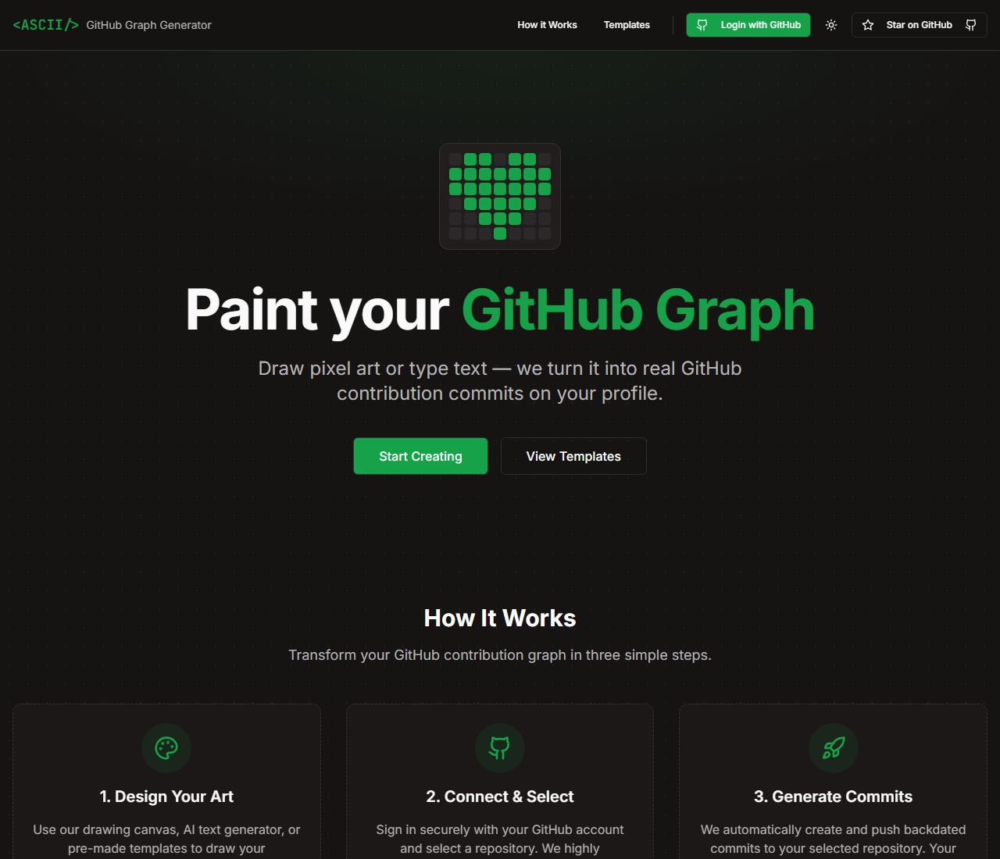
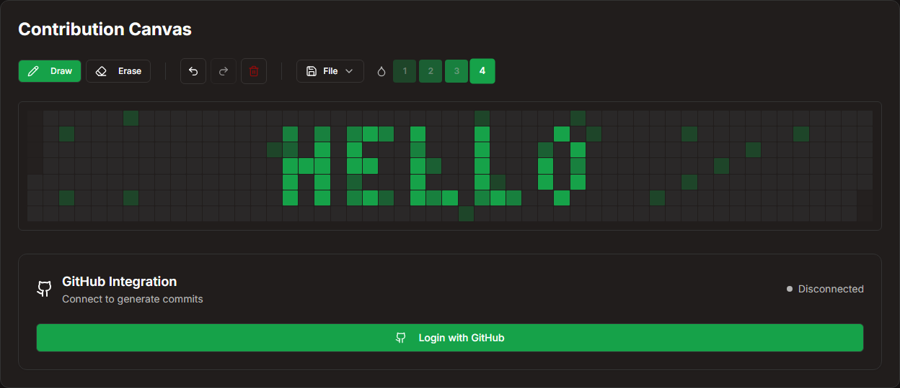
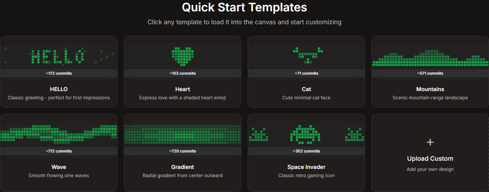
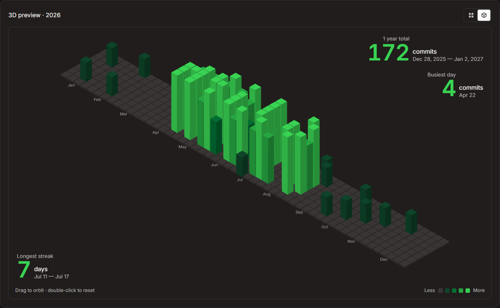

<div align="center">

# PixelGrapher

**Paint on your GitHub contribution graph.**
Draw pixel art or type a word, preview it in 2D and 3D, then push it to your profile as real, backdated commits.

[](https://pixel-grapher.vercel.app/)
[](https://nextjs.org/)
[](https://react.dev/)
[](https://www.typescriptlang.org/)
[](LICENSE)

<br/>



</div>

<br/>

## What it does

GitHub draws your activity as a 52 × 7 grid, one square per day. PixelGrapher gives you that grid as an editable canvas. You design a pattern, and the app turns each square into the right number of commits, dated to the matching day of the year, in a repository you choose.

The result is a profile that spells a word, shows a heart, or carries a tiny Space Invader.

## Features

### A canvas that matches GitHub's calendar
Pencil and eraser, four intensity levels, undo/redo, and import/export. The grid is aligned to the real calendar for the year you pick (52 or 53 weeks, starting on a Sunday), so what you draw is where it lands.



### Text to pattern
Type up to 13 characters and get them rendered in a compact 3 × 5 pixel font, centred on the grid. There are a few styles, including a solid, noise-free one called Pristine. It is a font renderer, not an AI model.

### One-click templates
HELLO, Heart, Cat, Mountains, Wave, Gradient and Space Invader, each with an estimated commit count. You can also upload your own pattern.



### 3D skyline preview
Before anything is pushed, you can see the pattern as a 2D heat map or fold it up into an isometric skyline. Bars rise in a wave from January to December, you can drag to orbit, hover a day for its commit count, and the stats (total commits, busiest day, longest streak) are the real numbers your pattern would create.



### Save and reuse
Patterns can be saved in your browser and loaded again later. Press `?` anywhere in the app for the keyboard shortcuts.

## How it works

1. **Design** a pattern on the canvas, from text, or from a template.
2. **Preview** it flat or as a 3D skyline.
3. **Connect** your GitHub account with OAuth and pick a repository.
4. **Generate.** The backend builds a commit plan from the grid, creates the commits in memory with [isomorphic-git](https://isomorphic-git.org/) (no git binary needed), and pushes them to the repository. Progress streams back to the browser live.

Intensity maps straight to commit count: a level-3 square is three commits on that day.

## Permissions, privacy and limits

Please read this before connecting your account.

- **Repository access.** Run as a GitHub App (the hosted version is being moved to this), PixelGrapher can only write to the repositories you pick on GitHub's install screen, with *Contents: read & write* and nothing else. In the older OAuth-app mode it asks for the broad `repo` scope instead, which includes all your private repositories. Either way, use a dedicated, empty repository for your art, and uninstall or revoke the app under *GitHub → Settings → Applications* when you are done.
- **No database, no server-side sessions.** After login the server hands your browser a sealed (AES-256-GCM) token that contains your GitHub access token. The server keeps nothing: it decrypts the token on each request and forgets it. The token expires after 7 days, is never written to disk or logged, and is passed to the browser in the URL fragment so it never reaches a server log. Because it is stateless, a server restart does not log you out. Changing `SESSION_SECRET` invalidates every token.
- **Browser storage.** The sealed token and your saved patterns are kept in your browser's `localStorage` / `sessionStorage`.
- **Commit cap.** A single run is limited to 2,000 commits and one job per user at a time.
- **Backdated commits are permanent.** Once pushed, they show on your profile until you remove them. The app includes a *reset repository* action that rewrites the history of the repo you chose, so only ever point it at a repository made for this.
- **Cold starts.** The backend runs on a free tier and can take up to a minute to wake up after being idle. The frontend pings it on load to shorten that wait.

> **Use it as creative art, not to fake work.** The graph is supposed to say something true about your activity. This project is for pixel art, not for padding a profile.

## Tech stack

| Area | Tools |
| --- | --- |
| Frontend | Next.js 16 (App Router), React 19, TypeScript, Tailwind CSS 4, Radix UI, Lucide icons, TanStack Query |
| 3D preview | A hand-written canvas renderer, no WebGL or 3D library |
| Backend | Node.js, Express, Passport (GitHub OAuth), isomorphic-git, memfs |
| Testing | Vitest (unit), Playwright (end to end) |
| Hosting | Vercel (frontend), Render (backend) |

## Run it locally

You need Node.js 20+ and a GitHub OAuth app.

### 1. Create a GitHub App (or an OAuth app)

Recommended: *GitHub → Settings → Developer settings → GitHub Apps → New GitHub App*. Give it **Repository permissions → Contents: Read and write**, set the callback URL below, set *Setup URL* to your frontend URL, and under *Optional features* opt out of *User-to-server token expiration*. Put the app's slug in `GITHUB_APP_SLUG` (step 2).

Simpler but broader: *Developer settings → OAuth Apps → New OAuth App*, and leave `GITHUB_APP_SLUG` empty.

| Field | Value |
| --- | --- |
| Homepage URL | `http://localhost:5173` |
| Authorization callback URL | `http://localhost:3000/api/auth/github/callback` |

Copy the Client ID and generate a Client Secret.

### 2. Start the backend

```bash
git clone https://github.com/WulfaW/PixelGrapher.git
cd PixelGrapher/backend
npm install
cp .env.example .env
```

Edit `backend/.env`:

```env
PORT=3000
GITHUB_CLIENT_ID=your_client_id
GITHUB_CLIENT_SECRET=your_client_secret
GITHUB_CALLBACK_URL=http://localhost:3000/api/auth/github/callback
GITHUB_APP_SLUG=your-github-app-slug   # leave empty for an OAuth app
FRONTEND_URL=http://localhost:5173
SESSION_SECRET=any_long_random_string
```

```bash
npm run dev
```

### 3. Start the frontend

```bash
cd ../frontend
npm install
echo "NEXT_PUBLIC_API_URL=http://localhost:3000" > .env.local
npm run dev
```

Open <http://localhost:5173>.

### Tests

```bash
cd frontend
npm run typecheck     # TypeScript
npm test              # unit tests (Vitest)
npx playwright test   # end-to-end tests

cd ../backend
npm test              # token and commit-plan tests
```

## Project layout

```
PixelGrapher/
├── frontend/             Next.js app
│   ├── src/app/          Next.js layout, metadata and page
│   ├── src/screens/      Page-level components
│   ├── src/components/   Canvas, templates, 3D skyline, GitHub panel…
│   ├── src/lib/          Pattern generators, templates, API helpers
│   └── tests/            Playwright end-to-end tests
├── backend/              Express API
│   ├── server/           Routes, OAuth, commit generation
│   └── shared/           Calendar maths shared with the frontend
└── docs/                 README screenshots
```

## Ideas for later

- [ ] Shareable links for a pattern
- [ ] Export the preview as a PNG
- [ ] More templates and a bigger pixel font

## Contributing

Issues and pull requests are welcome. For anything larger than a small fix, open an issue first so we can talk it through.

## License

[MIT](LICENSE) © WulfaW

<div align="center">
<br/>
Made with care by <a href="https://github.com/WulfaW"><b>WulfaW</b></a>
</div>
